# Práctica de Redes — Monitoreo SNMP con Zabbix

[](https://youtu.be/FKilNwnb92c)

> 🎥 **Video demostrativo:** https://youtu.be/FKilNwnb92c

<p align="center">
  <a href="https://github.com/MRMLD/Practica-de-Redes-Zabbix-/blob/main/README.md"></a>
</p>
<p align="center">
  <a href="https://github.com/MRMLD/Practica-de-Redes-Zabbix-/tree/main/scripts"></a>
  <a href="https://github.com/MRMLD/Practica-de-Redes-Zabbix-/tree/main/running-configs"></a>
  <a href="https://github.com/MRMLD/Practica-de-Redes-Zabbix-/tree/main/evidencias-snmp"></a>
</p>

| | |
|---|---|
| **Autor** | Mario de León |
| **Matrícula** | 20250682 |
| **Materia** | Seguridad de Redes |
| **Maestro** | Jonathan Rondón |
| **Institución** | ITLA |
| **Plataforma** | PNETLab |

---

## 📌 Propósito del laboratorio

El propósito de este laboratorio es implementar una red LAN con **monitoreo centralizado** usando **Zabbix** y **SNMP**, aplicando el principio de **mínimo privilegio**: el servidor de monitoreo puede **leer** la información de los equipos de red, pero no puede **modificar** su configuración.

Objetivos:

- Configurar el direccionamiento IP del router y del switch.
- Implementar un servidor **DHCP** en el router para la red LAN.
- Configurar una **comunidad SNMP de solo lectura (RO)** en el router y el switch.
- Configurar el servidor **Zabbix** como cliente DHCP.
- Verificar en Zabbix los datos SNMP del router y del switch.
- Comprobar que Zabbix detecta y registra un incidente (caída de un enlace).

---

## 🗺️ Topología

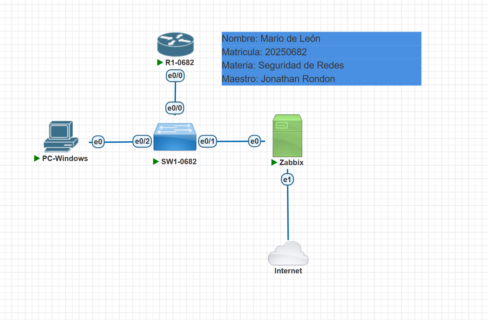

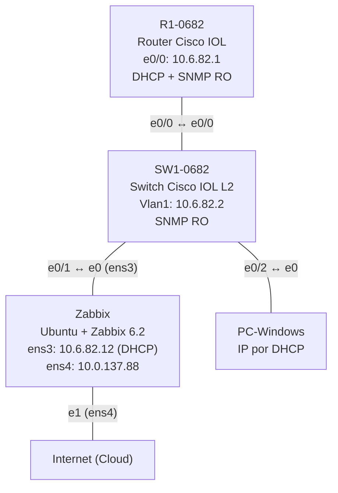

### Dispositivos y conexiones

| Dispositivo | Imagen en PNETLab | Puerto | Conectado a |
|---|---|---|---|
| R1-0682 | Cisco IOL | e0/0 | SW1-0682 e0/0 |
| SW1-0682 | Cisco IOL L2 | e0/1 | Zabbix e0 (ens3) |
| SW1-0682 | Cisco IOL L2 | e0/2 | PC-Windows e0 |
| Zabbix | Linux (Zabbix 6.2) | e1 (ens4) | Internet (Cloud) |

### Direccionamiento (basado en la matrícula 2025**0682**)

| Dispositivo | Interfaz | Dirección IP |
|---|---|---|
| R1-0682 | e0/0 | 10.6.82.1/24 |
| SW1-0682 | Vlan1 | 10.6.82.2/24 |
| Zabbix | ens3 (LAN) | 10.6.82.12/24 (DHCP) |
| Zabbix | ens4 (Cloud) | 10.0.137.88/24 (DHCP de la nube) |
| PC-Windows | e0 | 10.6.82.x/24 (DHCP) |
| Rango excluido del DHCP | — | 10.6.82.1 – 10.6.82.10 |
| Comunidad SNMP | — | `mario0682` (RO) |

---

## 🔄 Flujo de monitoreo SNMP

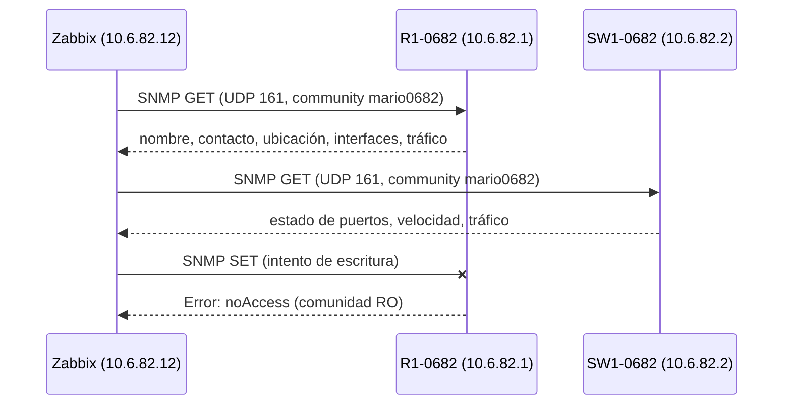

### Acceso al servidor Zabbix

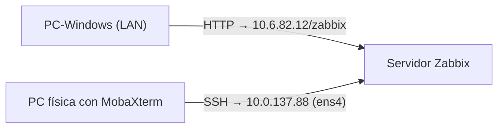

- La **interfaz web** de Zabbix se usó desde la **PC-Windows** del laboratorio (`http://10.6.82.12/zabbix`).
- Para ejecutar comandos en el servidor se usó la **consola de PNETLab** y también una sesión **SSH con MobaXterm** desde la PC física, a través de la interfaz `ens4` conectada a la nube. MobaXterm permite copiar y pegar fácilmente y muestra la salida con colores.

---

## ⚙️ Configuración

Los scripts aplicados están en la carpeta [`scripts/`](scripts/):

- [`R1-0682.txt`](scripts/R1-0682.txt): direccionamiento, DHCP y SNMP del router.
- [`SW1-0682.txt`](scripts/SW1-0682.txt): direccionamiento y SNMP del switch.
- [`zabbix-comandos.sh`](scripts/zabbix-comandos.sh): comandos usados en el servidor Zabbix.

Las configuraciones finales están en [`running-configs/`](running-configs/):

- [`R1-0682_running-config.txt`](running-configs/R1-0682_running-config.txt)
- [`SW1-0682_running-config.txt`](running-configs/SW1-0682_running-config.txt)
- [`ZABBIX_config-red.txt`](running-configs/ZABBIX_config-red.txt): configuración de red del servidor (los servidores Linux no tienen running-config; este es su equivalente).

La salida completa del `snmpwalk` a cada equipo está en [`evidencias-snmp/`](evidencias-snmp/).

---

## ✅ Verificación

### 1. Direccionamiento IP

Router R1-0682: la interfaz `Ethernet0/0` tiene la IP 10.6.82.1 en estado up/up.

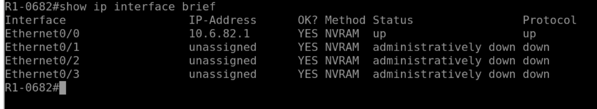

Switch SW1-0682: la interfaz `Vlan1` tiene la IP de gestión 10.6.82.2 en estado up/up.

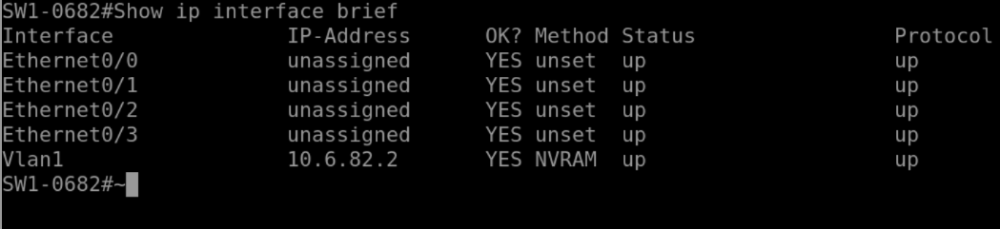

### 2. Servidor DHCP para la red LAN

Pool `LAN-0682` configurado en R1, con gateway, DNS y el rango 10.6.82.1–10.6.82.10 excluido para la infraestructura.

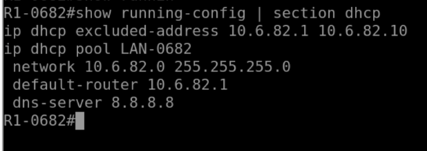

Asignaciones entregadas por el router (servidor Zabbix y PC-Windows), cada una con su MAC.

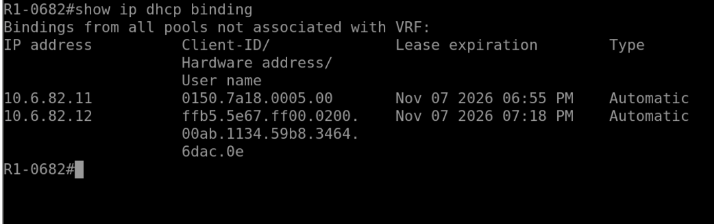

La PC-Windows obtuvo su IP por DHCP desde 10.6.82.1.

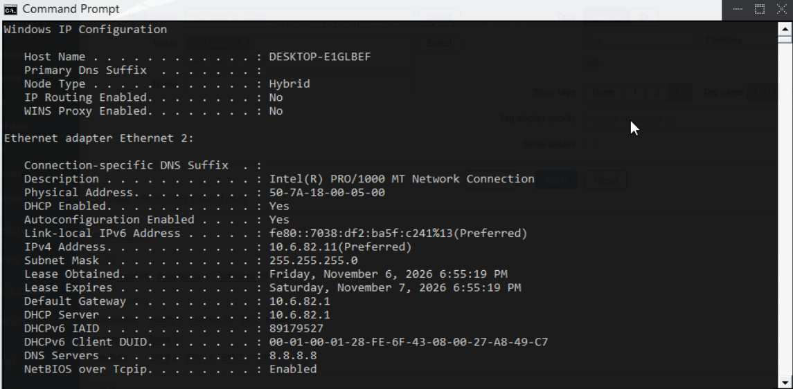

### 3. Comunidad SNMP de solo lectura

En R1-0682 la comunidad `mario0682` está configurada como **RO** (read-only), junto con el contacto y la ubicación.

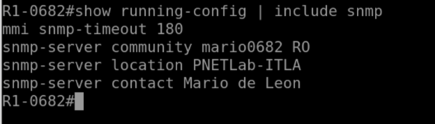
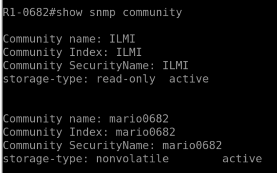

En SW1-0682 se aplicó la misma configuración.

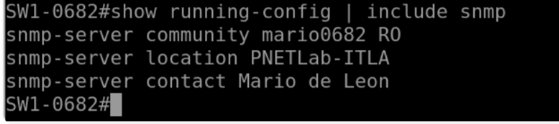
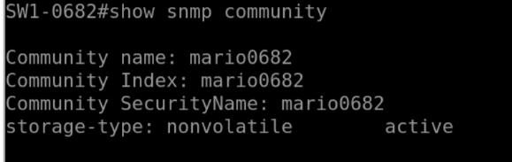

### 4. Servidor Zabbix como cliente DHCP

La interfaz `ens3` obtuvo la IP **10.6.82.12/24** de forma dinámica (`dynamic`).

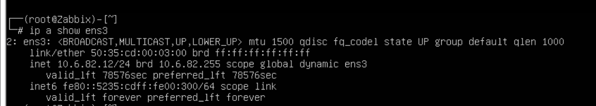

La ruta por defecto hacia 10.6.82.1 también fue aprendida por DHCP (`proto dhcp`).

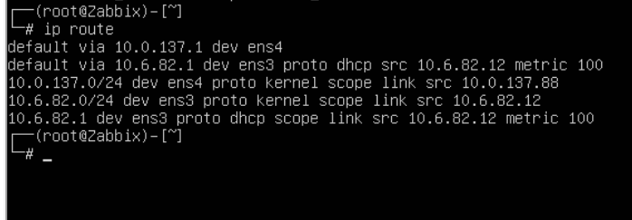

### 5. Prueba de SNMP de solo lectura desde el servidor Zabbix

**Lectura permitida.** Con `snmpget` se consultan el nombre (`.1.5.0`), el contacto (`.1.4.0`) y la ubicación (`.1.6.0`) del router y del switch.

> 💻 **Captura tomada con MobaXterm:** estos comandos se ejecutaron en el servidor Zabbix mediante una sesión **SSH desde MobaXterm** (usuario `user`, prompt `user@Zabbix`), conectada a la interfaz `ens4` (10.0.137.88). Por eso la salida aparece con colores y con un prompt distinto al de la consola de PNETLab.

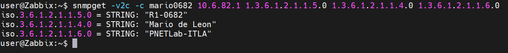
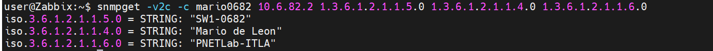

**Escritura denegada.** Al intentar cambiar el nombre de los equipos con `snmpset`, ambos responden `Reason: noAccess`, porque la comunidad es de solo lectura.

> 💻 **Captura tomada con MobaXterm:** la prueba se ejecutó en el servidor Zabbix a través de la misma sesión **SSH de MobaXterm** hacia `ens4` (10.0.137.88).

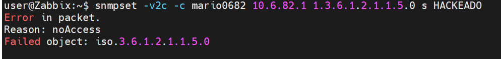
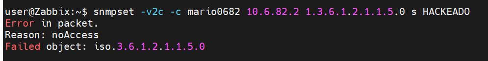

### 6. Datos SNMP en Zabbix

Router y switch registrados con el template **Cisco IOS SNMP**. El indicador **SNMP en verde** confirma que Zabbix recibe sus datos.

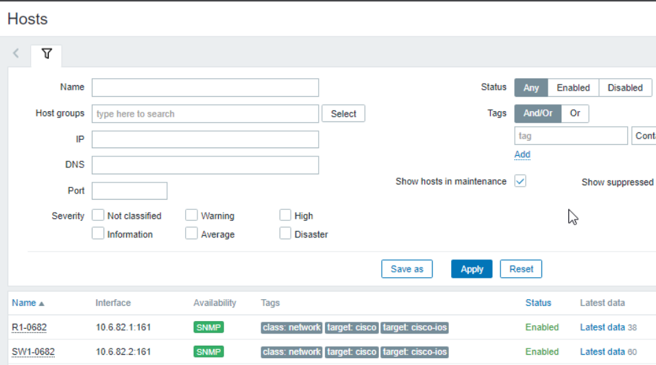

Datos recolectados del router (nombre, contacto, ubicación, disponibilidad e interfaces).

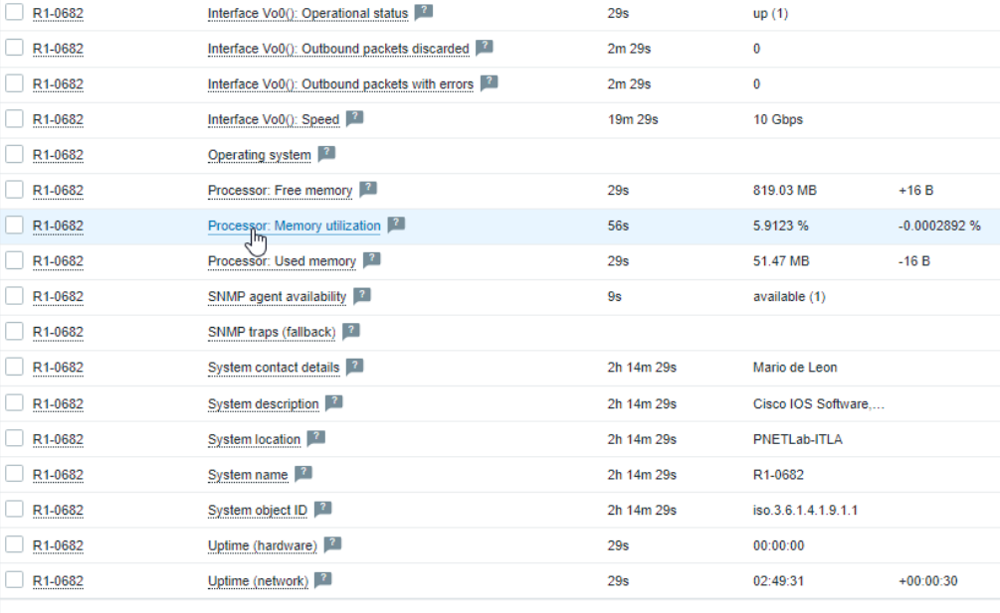

Datos recolectados del switch (estado y velocidad de cada puerto).

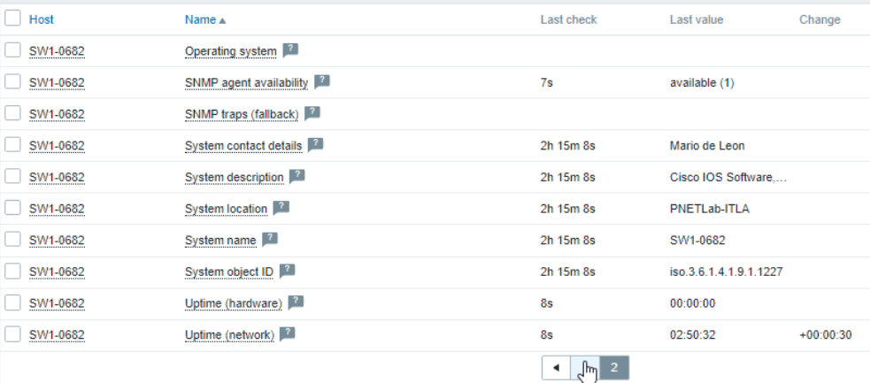

Historial de tráfico recibido en la interfaz Et0/0 del router.

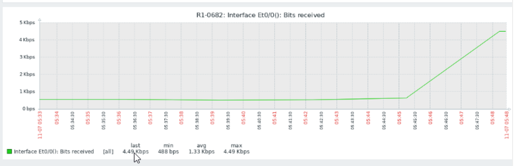

### 7. Detección de incidente

Para simular una caída de enlace se apagó el puerto **e0/2** de SW1-0682 (donde está conectada la PC-Windows):

```
configure terminal
interface e0/2
shutdown
end
```

Zabbix detectó el problema **"Interface Et0/2(): Link down"** con severidad **Average**. Sin embargo, la alerta **no se pudo capturar mientras estaba activa**: la PC-Windows era el equipo desde donde se accedía a la interfaz web de Zabbix y, al apagar su puerto, quedó desconectada de la red y sin acceso a la página.

Por eso, después de unos minutos se restableció el puerto con `no shutdown` y se consultó el historial en **Monitoring → Problems → History**. Allí se ve que Zabbix sí registró el incidente completo:

| Campo | Valor |
|---|---|
| Inicio del problema | 05:52:16 |
| Hora de recuperación | 05:57:16 |
| Duración | 5 minutos |
| Severidad | Average |
| Estado | **RESOLVED** |

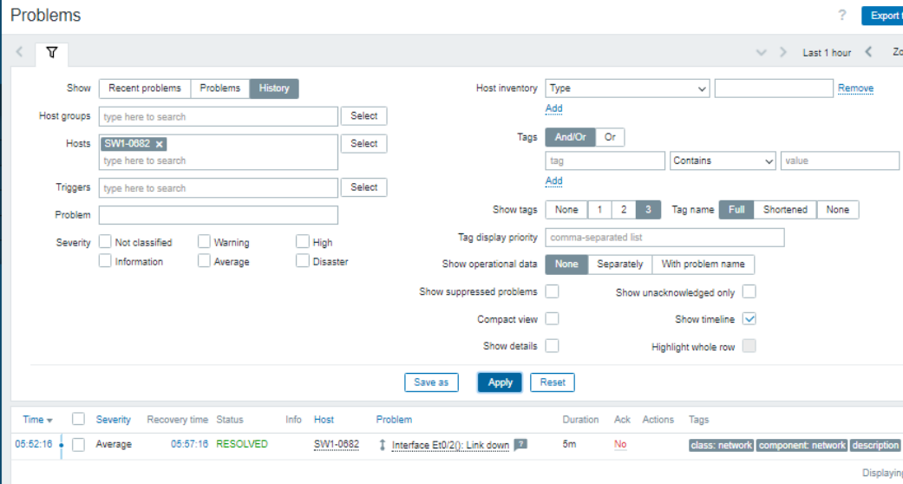

Esto demuestra que Zabbix detecta los incidentes aunque el administrador no los esté viendo en ese momento, y que deja un registro con la hora de inicio, la de recuperación y la duración, útil para auditoría.

---

## 🔐 Análisis de seguridad

- **Mínimo privilegio:** la comunidad SNMP es **RO**. Zabbix puede leer datos, pero nadie puede modificar la configuración por SNMP (comprobado con `snmpset` → `noAccess`).
- **Comunidad personalizada:** no se usan las comunidades por defecto `public` / `private`.
- **Control del direccionamiento:** el rango 10.6.82.1–10.6.82.10 está excluido del DHCP y reservado para la infraestructura.
- **Trazabilidad:** `show ip dhcp binding` permite identificar qué equipos (MAC) están conectados a la red.
- **Detección de incidentes:** Zabbix alerta automáticamente ante caídas de enlace o pérdida de comunicación SNMP y guarda el historial.
- **Limitación:** SNMPv2c transmite la comunidad en texto plano. En un entorno de producción se recomienda **SNMPv3** (autenticación y cifrado) y una **ACL** que permita consultas SNMP solo desde el servidor Zabbix.

---

## 📁 Estructura del repositorio

```
├── README.md
├── images/            # Capturas de la configuración y la verificación
├── scripts/           # Scripts de configuración aplicados
├── running-configs/   # Configuraciones finales de R1, SW1 y red del servidor Zabbix
└── evidencias-snmp/   # Salida completa de snmpwalk a R1 y SW1
```
